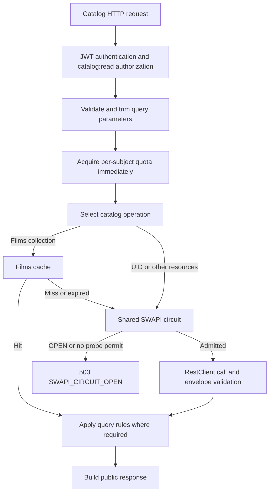

# Architecture and code guide

## Boundaries

The application groups code by feature. Controllers own HTTP validation and
response concerns; application services own use cases; SWAPI infrastructure owns
provider-specific envelopes and network behavior. Constructor injection makes
dependencies explicit. Records represent immutable public/application results.

| Package | Responsibility | Important types |
| --- | --- | --- |
| `api` | Public API information and OpenAPI configuration. | ApiInfoController, OpenApiConfiguration. |
| `auth.controller` | Registration/login HTTP and registration error mapping. | LoginController, RegistrationController, RegistrationErrorHandler. |
| `auth.service` | Authenticate, register, and issue tokens through an application port. | LoginService, RegistrationService, AccessTokenIssuer, AuthenticatedUser, IssuedToken. |
| `auth.jwt` | RS256 implementation, key loading, claims, and validation. | JwtAccessTokenIssuer, JwtConfiguration. |
| `auth.security` | Spring Security chains, password encoder/provider/store, registration attempt limit. | SecurityConfiguration, UserAuthenticationConfiguration, AuthRateLimiter. |
| `catalog.api` | Validate queries, charge catalog quota, and map catalog failures to HTTP. | CatalogController, CatalogErrorHandler. |
| `catalog.application` | Select operations, combine filters, order Films, and paginate complete matches. | CatalogService, CatalogGateway, CatalogItem, CatalogPage. |
| `catalog.infrastructure.swapi` | External HTTP, envelope validation, bounded scans, collection cache, and circuit. | SwapiCatalogAdapter, SwapiClient, SwapiResponseMapper, CompleteResourceReader, FilmsCache, SwapiCircuit. |
| `ratelimit` | Independent bounded identity/origin/subject registries and local 429 responses. | RequestQuotas, IdentityQuota, QuotaErrorHandler. |
| `telemetry` | Sanitized HTTP observations, normalized routes, metrics, traces, and logs. | TelemetryConfiguration, TelemetryPrivacyHandler, HttpObservationLoggingHandler. |

`auth.exception` contains registration domain exceptions; HTTP advice remains in
`auth.controller`. AuthenticatedUser belongs to the service layer. LoginService
depends on AccessTokenIssuer, whose JWT implementation returns IssuedToken;
the controller maps that result to LoginResponse. Services do not depend on
controller DTOs.

## Catalog request order

This shows ordering, not every failure branch. For Films, the cache stores the
validated unsorted source collection; CatalogService sorts by numeric UID and
applies each request's filtering and pagination. A cache hit still consumes
quota, but does not acquire a circuit permit or update provider-call metrics.

Without ID/name, People/Starships/Vehicles preserve the provider page order and
metadata. UID requests make one detail call and combine a supplied name with AND.
Name searches return complete candidates and are filtered/paginated locally.
Regex metacharacters trigger a bounded full-resource read so public matching
remains literal rather than inheriting SWAPI regex behavior.

## Contracts worth preserving

- [CatalogGateway](../src/main/java/com/conexa/starwars/catalog/application/CatalogGateway.java)
  separates use cases from external infrastructure. Optional.empty means verified
  detail absence; provider failures throw CatalogFailure. A search may return a
  complete superset for application filtering when a literal fallback scan is used.
- [CatalogPage](../src/main/java/com/conexa/starwars/catalog/application/CatalogPage.java)
  copies page items and calculates local offsets with long. Totals describe all
  matches before slicing; a page beyond the local total is empty without losing totals.
- [SwapiClient](../src/main/java/com/conexa/starwars/catalog/infrastructure/swapi/SwapiClient.java)
  uses Boot's instrumented RestClient.Builder, translates network/provider errors,
  and validates envelopes before a circuit probe can count as successful.
- [CompleteResourceReader](../src/main/java/com/conexa/starwars/catalog/infrastructure/swapi/CompleteResourceReader.java)
  requires complete reads within 20 pages and a 30-second budget, rejecting
  inconsistent totals and duplicate UIDs instead of returning partial totals.
- [FilmsCache](../src/main/java/com/conexa/starwars/catalog/infrastructure/swapi/FilmsCache.java)
  has one stable key, a five-minute write TTL, a size bound of one, and coordinated
  loading. Exceptions are not converted to cached successes.
- [SwapiCircuit](../src/main/java/com/conexa/starwars/catalog/infrastructure/swapi/SwapiCircuit.java)
  records only eligible physical calls. Confirmed absence releases a permit
  without counting as success/failure or falsely recovering HALF_OPEN. Contract
  errors are ignored by the configured failure predicate and still propagate.

## Security and instance-local state

Login quotas are checked before AuthenticationManager performs expensive password
verification. Identity and connection-origin buckets are independent: changing
usernames does not bypass the origin limit, and changing origins does not bypass
the username limit. Registration retains its separate AuthRateLimiter.

RegistrationService hashes outside the user-store monitor, then atomically checks
username uniqueness, checks the address quota, creates the user, and records the
address. Failed registration does not reserve an address. The service trusts that
its HTTP caller has validated username/password and supplies the connection address.

| State | Owner | Lifetime |
| --- | --- | --- |
| User accounts and registered addresses | In-memory user store and RegistrationService | Current instance; lost on restart. |
| Login/catalog quota registries | RequestQuotas | Current instance; idle entries reclaimed on access. |
| Films collection | FilmsCache | Five minutes after write; lost on restart. |
| Circuit window/state | Shared `swapi` CircuitBreaker | Current instance; resets on restart. |
| Signing keys | Environment configuration | Independent of process restart until changed. |

Restarting does not itself revoke a previously issued JWT when the signing keys,
issuer, and audience remain unchanged. Validation is stateless and does not look
up an account for every catalog request. Persistent users, global quotas, shared
cache/circuit policy, and revocation require additional design across instances.

## Code documentation conventions

Javadoc describes contracts, preconditions, concurrency, failure classification,
and time/state boundaries. It does not repeat self-explanatory field accessors.
Names, comments, errors, and guides are in English. When changing behavior, update
the relevant guide, OpenAPI annotations, release notes, and meaningful tests.

The [provider matrix](swapi-response-matrix.md) and captured fixtures are historical
evidence, not a schema to rename. Keep upstream fields and raw measurements intact.
